# Work Requirement 3 - PRO2003

## Project Description

This work requirement improves and protects the PostgreSQL database for a strength training and progression platform. The database stores users, workout programs, exercises, and the planned sets, repetitions and target RIR for each exercise in a program. 

This branch builds on the database from Work Requirements 1 and 2 (branches `main` and `workreq2`). The ER model, tables, test data and queries from those work requirements are still included. 

This work requirement covers: 

- a review of the database against third normal form (3NF)
- an index evaluated with `EXPLAIN ANALYZE` before and after
- a transaction with several SQL statements
- limited database users with suitable privileges
- a backup restored into a separate database

## ER Model

The ER model uses Crow's Foot notation to show the relationships between
the tables.

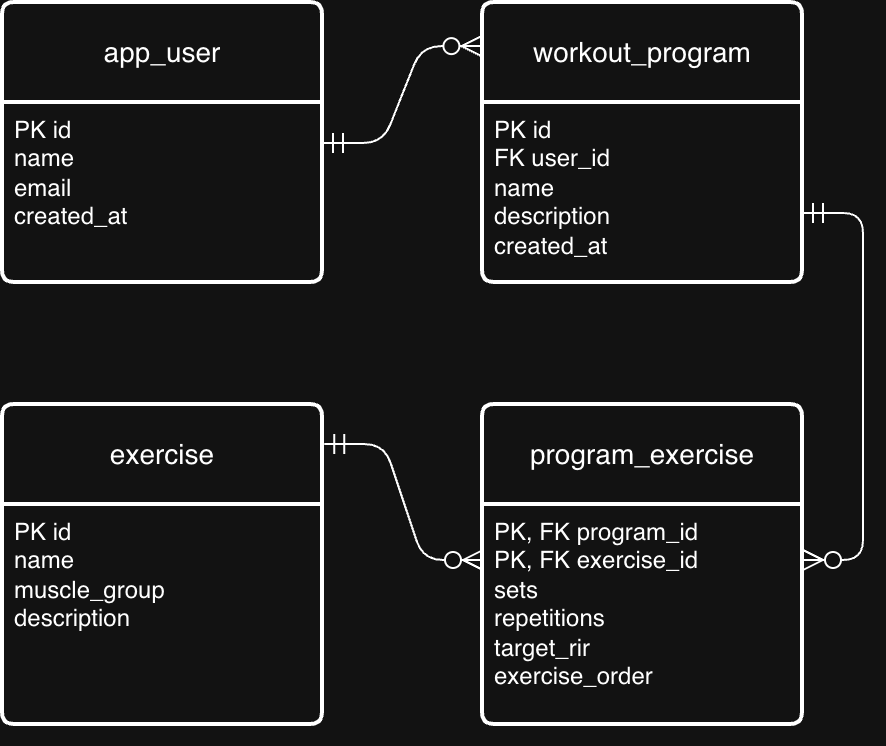

The editable diagram is available in `docs/er-diagram.drawio`.

## Tables and Relationships

The database contains four tables:

- `app_user`: Stores users' names, email addresses, and creation times.
- `workout_program`: Stores programs and identifies the user each program
  belongs to.
- `exercise`: Stores exercise names, muscle groups, and optional
  descriptions.
- `program_exercise`: Connects programs and exercises and stores the
  planned training details.

There is a one-to-many relationship between `app_user` and
`workout_program`. A user can have zero or more programs, while each
program must belong to exactly one user.

There is a many-to-many relationship between programs and exercises. The
intermediate table `program_exercise` resolves it through two one-to-many
relationships. It uses a composite primary key of `program_id` and
`exercise_id`, and sets, repetitions, target RIR and order are stored
there because they can differ between programs using the same exercise.

## Constraints

- Primary keys uniquely identify each row.
- Foreign keys require referenced users, programs and exercises to exist.
- `NOT NULL` makes required values mandatory.
- `UNIQUE` prevents duplicate email addresses and exercise names.
- `CHECK` requires sets, repetitions and exercise order to be greater than
  zero. Target RIR is optional but cannot be negative.
- The combination of `program_id` and `exercise_order` is unique, so two
  exercises cannot occupy the same position in one program.

## SQL Files 

- `database/schema.sql`: creates the tables and constraints, and the index on `program_exercise(exercise_id)`.
- `database/seed.sql`: populates the database with test data. It empties the tables first.
- `database/data_operations.sql`: demonstrates `INSERT`, `UPDATE` and `DELETE`.
- `database/queries.sql`: documented queries.
- `database/transactions.sql`: one successful and one failing transaction.
- `database/security.sql`: database users and privileges.

## How To Run 

A running PostgreSQL server and a database client such as DBeaver are required. In this project PostgreSQL runs in a Docker container named `ONF-Postgres` on port 5435. 

1. Create an empty database called `strength_training_project`.
2. Run `database/schema.sql`, then `database/seed.sql`.
3. Run `database/security.sql`. Replace the placeholder passwords with
   your own first, and do not commit them.
4. Optionally run `database/data_operations.sql` and
   `database/queries.sql`.
5. Run the two transactions in `database/transactions.sql` one at a time.
   The second transaction is designed to fail on a `CHECK` constraint.

## Normalization (3NF)

The tables were reviewed to check that the database is in third normal
form. In each table, the columns describe the row itself, and other tables
are only referred to by id, so the same information is not stored in more
than one place.

- `app_user` stores name, email and creation time, which all describe the
  user. The email is only stored here, so if it changes, it only has to be
  updated in one place.
- `workout_program` stores the program's name, description and creation
  time. The owner is only stored as `user_id`, so the user's name and
  email only exist in `app_user`. If a user changes email, it only has to
  be updated in one place.
- `exercise` stores the exercise's name, muscle group and description.
  Programs only refer to an exercise by its id, so the exercise name
  exists in one place and only has to be changed there.
- `program_exercise` stores sets, repetitions, target RIR and order,
  because they belong to one exercise in one specific program. The
  exercise name is not stored here, only the id, so the name exists in one
  place.

## Performance

### Index

An index was added on `program_exercise(exercise_id)`. It is created in
`database/schema.sql`.

```sql
CREATE INDEX IF NOT EXISTS idx_program_exercise_exercise_id
ON program_exercise(exercise_id);
```

`exercise_id` is a foreign key that is used when joining
`program_exercise` with `exercise`, and when looking up all programs that
use a given exercise. PostgreSQL does not create an index on foreign keys
automatically, and the primary key of `program_exercise` starts with
`program_id`, so it does not help when searching by `exercise_id`.

### Query plans

Two queries were examined with `EXPLAIN ANALYZE`: Query 8 (the number of
programs using each exercise) and a lookup of one exercise:

```sql
SELECT * FROM program_exercise WHERE exercise_id = 12;
```

Before the index, the lookup used a sequential scan with the filter
`exercise_id = 12` and removed 30 of the 32 rows. After the index was
created, the plan was still a sequential scan.

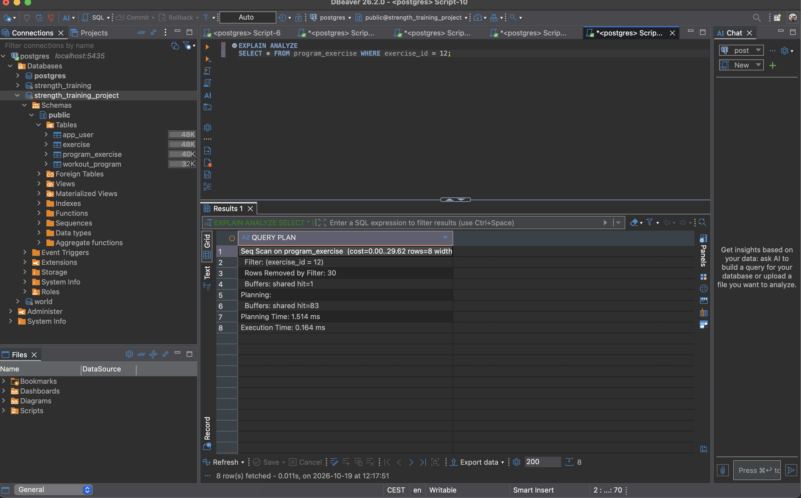

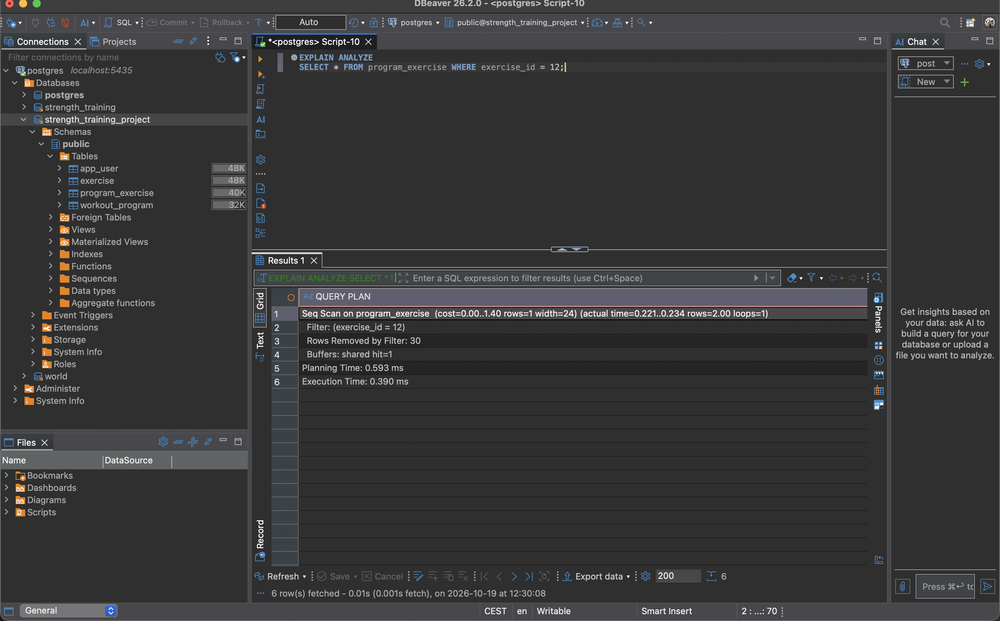

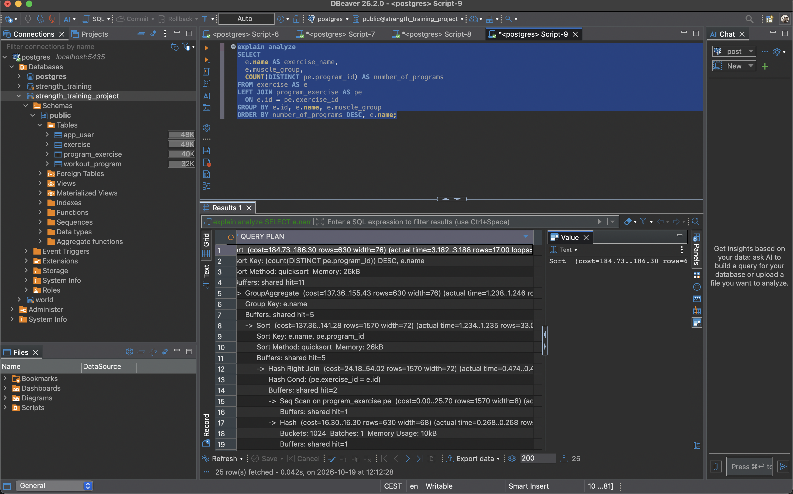

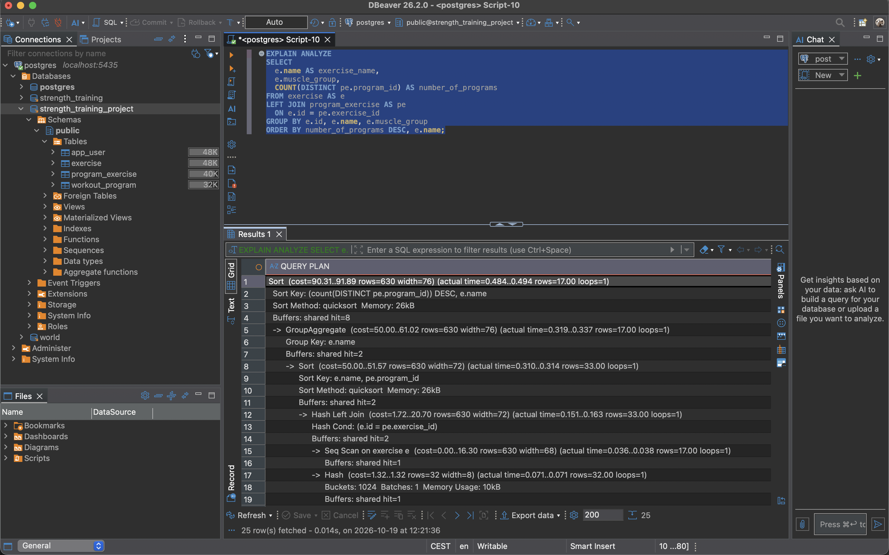

### Discussion

PostgreSQL chose not to use the index because the table only has 32 rows,
and reading the whole table is cheaper than looking up the index first.
Query 8 also returns all exercises with no `WHERE` condition, so every row
has to be read anyway. The index is therefore not beneficial on the
current data, and the differences in execution time between the plans are
too small to say anything about. It is justified by the expected growth:
when `program_exercise` contains many more rows, it allows PostgreSQL to
find the rows for one exercise without reading the whole table. This
should be tested again with a larger data set.

## Data Consistency: Transactions

Creating a workout program involves more than one change: the program
itself is inserted into `workout_program`, and its exercises are inserted
into `program_exercise`. If only part of this succeeded, the database
could end up with a program that is missing exercises. The operation is
therefore wrapped in an explicit transaction, so that all the changes
succeed together or none of them are saved.

The transactions are in `database/transactions.sql`.

### Successful transaction

The first transaction inserts a program called `Transaction Test` for one
user and two exercises that belong to it, and then ends with `COMMIT`.
Both the program and its two exercises were saved afterwards.

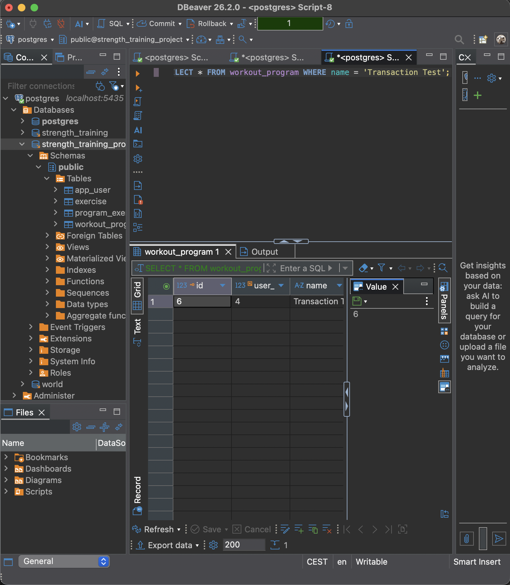

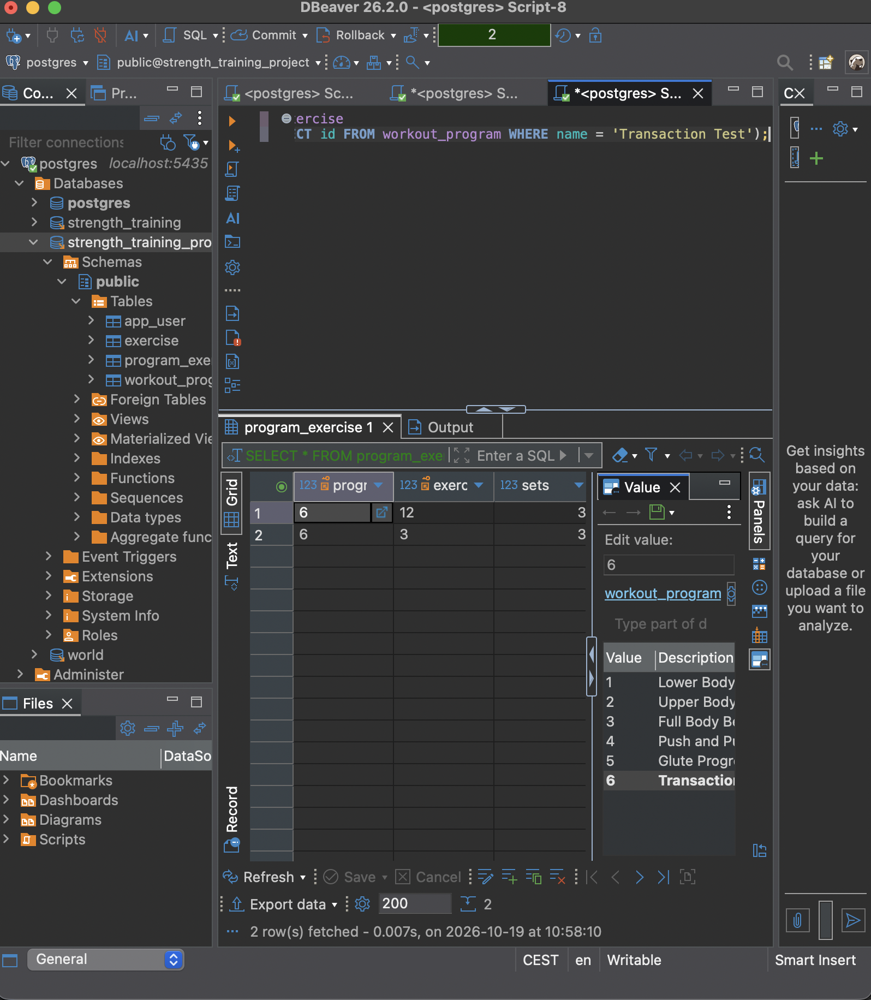

### Failed transaction

The second transaction does the same, but one of the exercises has
`sets = 0`. This violates the `CHECK (sets > 0)` constraint, so PostgreSQL
rejected the insert. After a `ROLLBACK`, the program that had been
inserted earlier in the same transaction was not saved either.

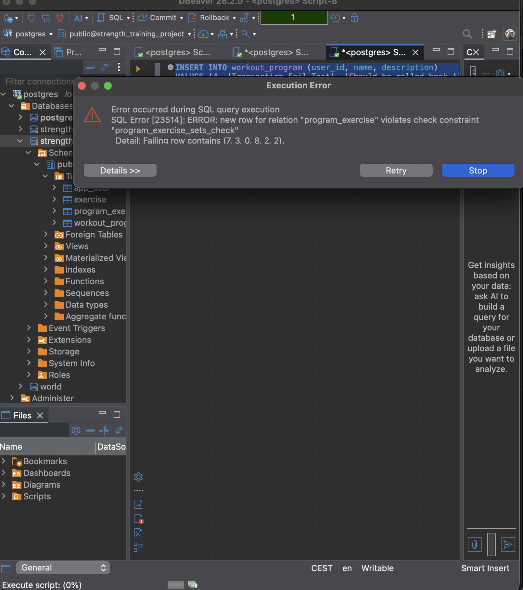

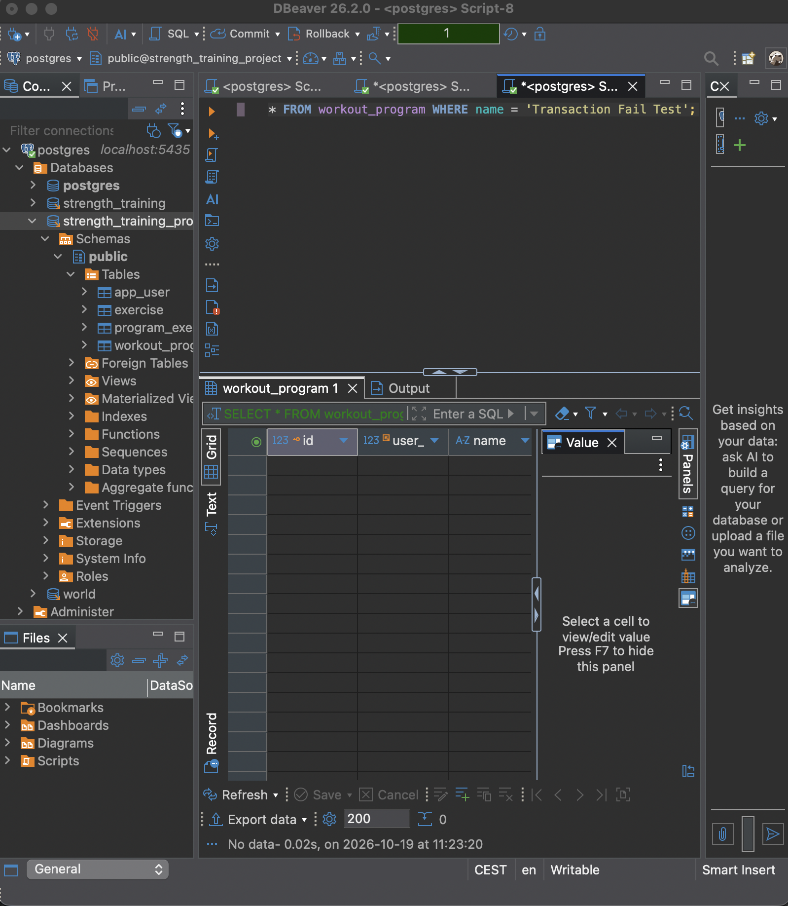

### Notes

- The transactions were tested in DBeaver using manual commit mode, so it
  was possible to decide when to commit or roll back.
- The identity counter is not rolled back. The failed program was given id
  7 even though it was never saved, so the next program will not use that
  number. This is normal behaviour in PostgreSQL.
- The test data from the successful transaction was deleted afterwards, so
  the database is back to its original data.

## Access Control

Two PostgreSQL users are defined in `database/security.sql`:

- `workout_reader` can only read data (`SELECT`) from all four tables.
- `workout_app` is intended for the application. It can read, insert and
  update users, read, insert, update and delete workout programs and their
  exercises, and only read the exercise catalogue.

Neither user is an administrator, and neither can create or drop tables.
This follows the principle of least privilege: each account only gets the
permissions it needs.

The passwords in `security.sql` are placeholders (`change_me_reader` and
`change_me_app`). Real passwords must be chosen locally before running the
script and must not be committed to Git, since database passwords should
not be stored in source code.

### Testing the permissions

A separate connection was created in DBeaver for each user, and operations
they should not be allowed to do were tried:

- `workout_reader` tried to insert a row into `exercise` and got
  `permission denied for table exercise`.
- `workout_app` tried to delete a row from `exercise` and got
  `permission denied for table exercise`, since it only has `SELECT` on
  that table.
- `workout_app` tried to drop the `exercise` table and got
  `must be owner of table exercise`.

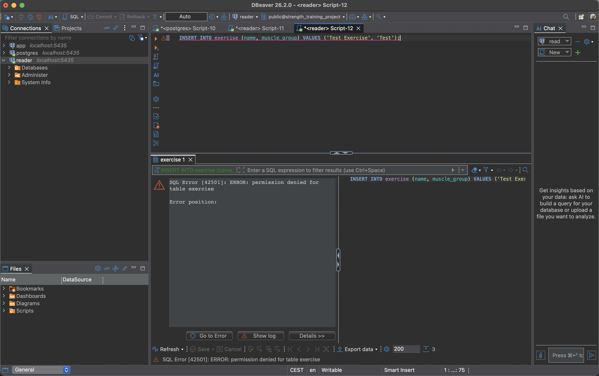

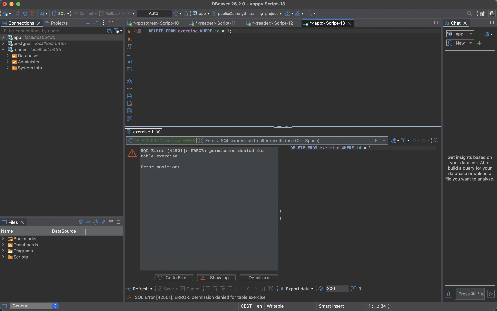

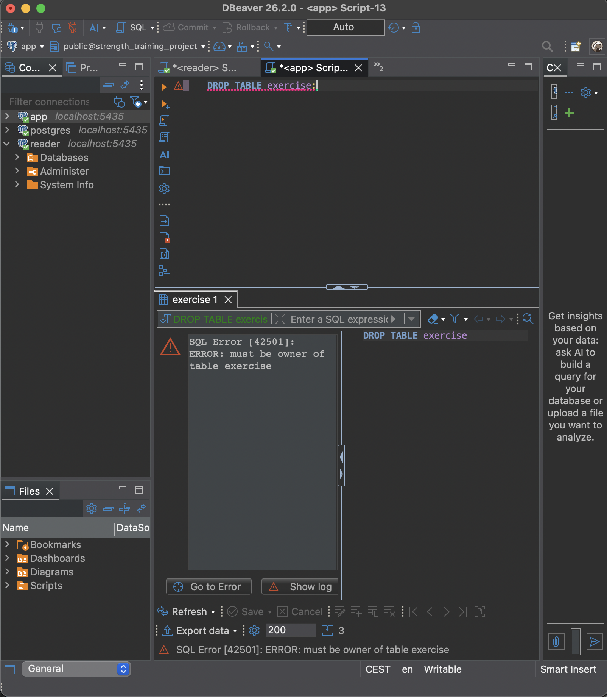

## Backup and Recovery

The database runs in a Docker container named `ONF-Postgres`. A backup is
created with `pg_dump` inside the container, and then copied out to a
folder outside the project, so it is stored separately from the database
and is not committed to Git.

### Create a backup

```bash
docker exec ONF-Postgres pg_dump -U postgres -d strength_training_project -F c -f /tmp/strength_training_project.dump
mkdir -p ~/db-backups
docker cp ONF-Postgres:/tmp/strength_training_project.dump ~/db-backups/strength_training_project_2026-10-20.dump
```

The backup uses PostgreSQL's custom format (`-F c`). The date is part of
the file name so older backups are not overwritten.

### Restore a backup

The backup is restored into a new, empty database so the original is not
touched:

```bash
docker exec ONF-Postgres createdb -U postgres strength_training_project_restored
docker cp ~/db-backups/strength_training_project_2026-10-20.dump ONF-Postgres:/tmp/restore.dump
docker exec ONF-Postgres pg_restore -U postgres -d strength_training_project_restored /tmp/restore.dump
```

### Verifying the restore

After restoring, the rows in each table were counted and the indexes were
checked. The restored database had 4 users, 5 workout programs, 17
exercises and 32 program exercises, which matches the original, and the
index `idx_program_exercise_exercise_id` was included. The table
privileges for `workout_reader` and `workout_app` were also included.

### Reliability considerations

**Backup frequency.** The app stores training history that cannot be
recreated if it is lost. To limit data loss, a daily automated backup with
several retained versions would be appropriate in production. Backups are
currently taken manually.

**Downtime.** Some downtime is acceptable for this type of application,
and restoring from a backup only takes a few commands.

**Replication.** A standby database would reduce downtime if the main
server failed, but is not necessary at this size and would add complexity.
It would also not replace backups, since a replica also copies mistakes
such as an accidental `DELETE`.

### Limitation

The backup includes the table privileges, but not the database users
(`workout_reader` and `workout_app`), since users belong to the whole
server. On a new server the users must be created first with
`database/security.sql`.


